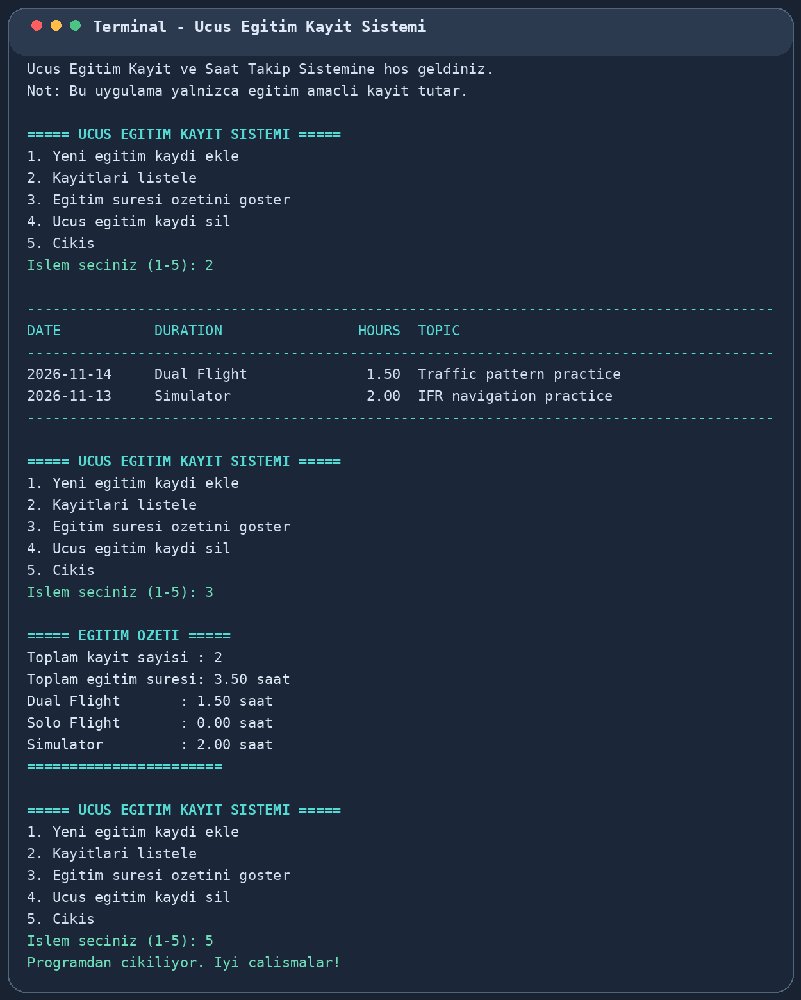

# Uçuş Eğitim Kayıt ve Saat Takip Sistemi

**Ders:** GEP1316 Kodlama Okuryazarlığı  
**Ödev:** Ara Değerlendirme Ödevi 1  
**Öğrenci:** Hüseyin Can Sevinç

## 1. Projenin amacı

Bu komut satırı uygulaması, pilotaj eğitimi sırasında yapılan Dual Flight, Solo Flight ve simülatör oturumlarını tarih, süre ve ders konusu ile kaydetmek; geçmiş kayıtları listelemek ve toplam eğitim sürelerini takip etmek için hazırlanmıştır.

Her kayıt `date`, `duration`, `hours` ve `topic` alanlarından oluşur. Kayıtlar UTF-8 biçiminde `ucus_egitim_kayitlari.csv` dosyasına yazılır ve uygulama yeniden açıldığında dosyadan yüklenir.

> **Kullanım sınırı:** Bu proje yalnızca eğitim amaçlı kişisel kayıt ve Python programlama çalışması içindir. Gerçek uçuş planlaması, yakıt/performans hesabı, uçuş izni, uçuşa elverişlilik veya operasyonel karar desteği sağlamaz. Uygulamadaki 8 saatlik giriş sınırı yalnızca yazılım doğrulamasıdır; havacılık mevzuatı veya uçuş limiti değildir.

## 2. Özellikler

1. Yeni eğitim kaydı ekleme (tarih, eğitim türü, süre ve konu doğrulaması)
2. Kayıtları tablo biçiminde listeleme
3. Toplam ve eğitim türüne göre süre özeti
4. Kayıt silme (kayıt numarası, E/H onayı ve iptal seçeneği)
5. Menü döngüsü üzerinden uygulamadan çıkış
6. CSV dosyasına kalıcı kayıt ve açılışta kayıtları yeniden yükleme
7. Hatalı veya eksik CSV satırlarını atlayarak geçerli kayıtları koruma

## 3. Ödev gereksinimleriyle eşleşme

| Ödev gereksinimi | Uygulamadaki karşılığı |
|---|---|
| En az 3 farklı girdi ve doğrulama | Tarih, eğitim türü, süre ve ders konusu |
| En az 2 karar yapısı | `if/elif/else` menüsü ve girdi doğrulama koşulları |
| En az 1 döngü | Ana menü ve hatalı girdiyi tekrar isteyen `while` döngüleri |
| En az 3 fonksiyon | `parse_date`, `parse_duration`, `load_records`, `save_records`, `summarize_records` ve diğerleri |
| Liste veya sözlük | Kayıt listesi ve her kaydı tutan sözlük |
| Biçimli ekran çıktısı ve dosyaya kayıt | Konsol tablosu/özeti ve CSV dosyası |
| En az 5 test senaryosu | `docs/TEST_SENARYOLARI.md` ve `tests/test_app.py` |
| GitHub dokümantasyonu | `README.md`, `PROMPTLAR.md`, rapor ve ekran görüntüsü |

## 4. Kurulum ve çalıştırma

Python 3.10 veya daha yeni bir sürüm yeterlidir. Harici paket gerekmez.

```bash
python main.py
```

Uygulama menüsü:

```text
1. Yeni egitim kaydi ekle
2. Kayitlari listele
3. Egitim suresi ozetini goster
4. Ucus egitim kaydi sil
5. Cikis
```

Kayıtlar varsayılan olarak proje klasöründeki `ucus_egitim_kayitlari.csv` dosyasında saklanır. Başka bir dosya yolu kullanmak için `FLIGHT_LOG_DATA` ortam değişkeni tanımlanabilir.

## 5. Testleri çalıştırma

Proje ana klasöründe:

```bash
python -m unittest discover -s tests -v
```

Toplam 34 otomatik test girdi doğrulama, CSV okuma/yazma, özet hesaplama, kayıt ekleme, silme/iptal, atomik dosya kaydı, hata durumunda geri alma ve menü akışını kapsar. Testler gerçek kullanıcı CSV dosyası yerine geçici klasör kullanır.

## 6. Proje dosyaları

```text
Ucus_Egitim_Kayit_Sistemi/
├── main.py
├── .gitignore
├── README.md
├── PROMPTLAR.md
├── requirements.txt
├── RAPOR.docx
├── RAPOR.pdf
├── TESLIM_ONCESI_KONTROL.md
├── tests/
│   └── test_app.py
├── docs/
│   ├── TEST_SENARYOLARI.md
│   └── akis_semasi.png
└── screenshots/
    └── uygulama_ornek_cikti.png
```

## 7. Örnek uygulama çıktısı

Aşağıdaki görsel, bu depodaki `main.py` dosyası çalıştırılarak örnek kayıtlarla alınmıştır. Menü numaraları ve çıktılar güncel kodla aynıdır.



## 8. Veri ve gizlilik

Uygulama ad, telefon veya öğrenci numarası istemez. Sadece eğitim kaydına ait tarih, tür, saat ve konu alanları tutulur. CSV dosyası yerel proje klasöründe saklanır.
